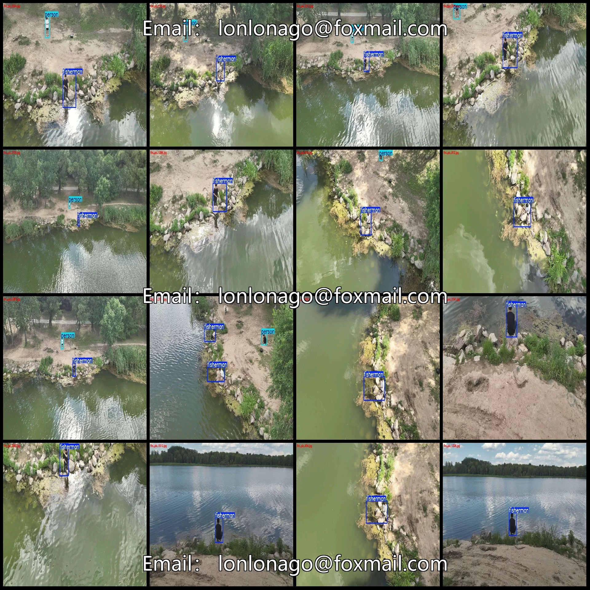
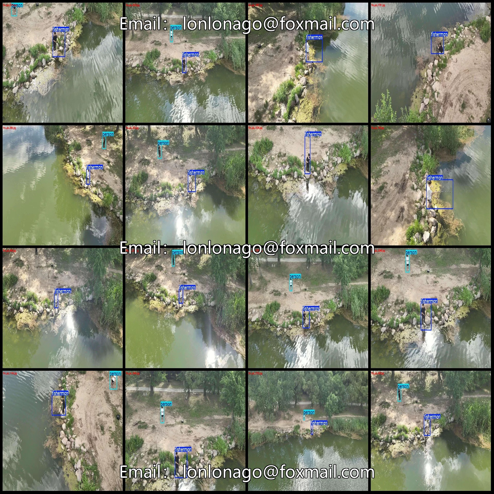
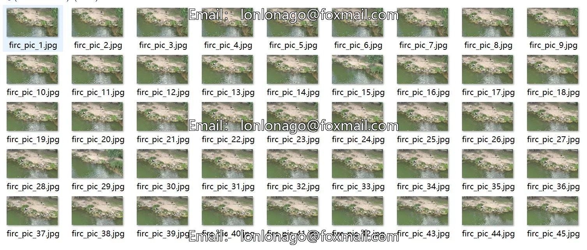
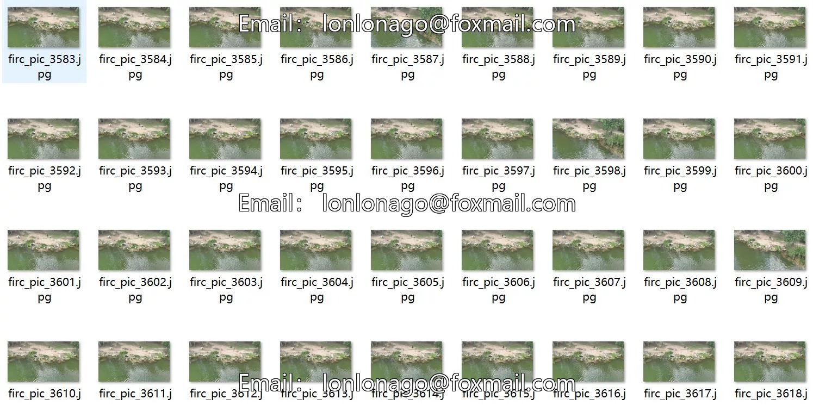
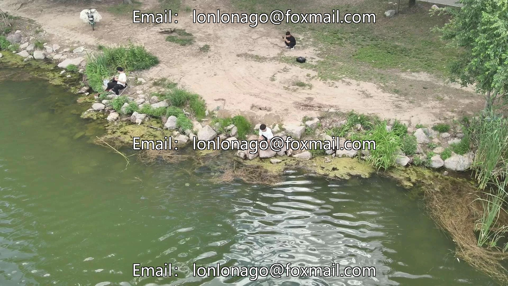
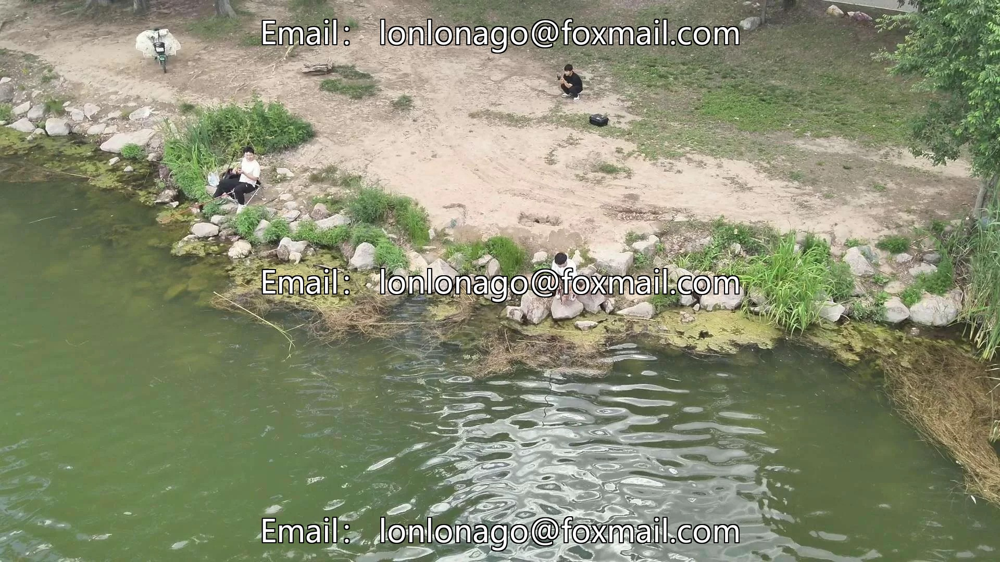
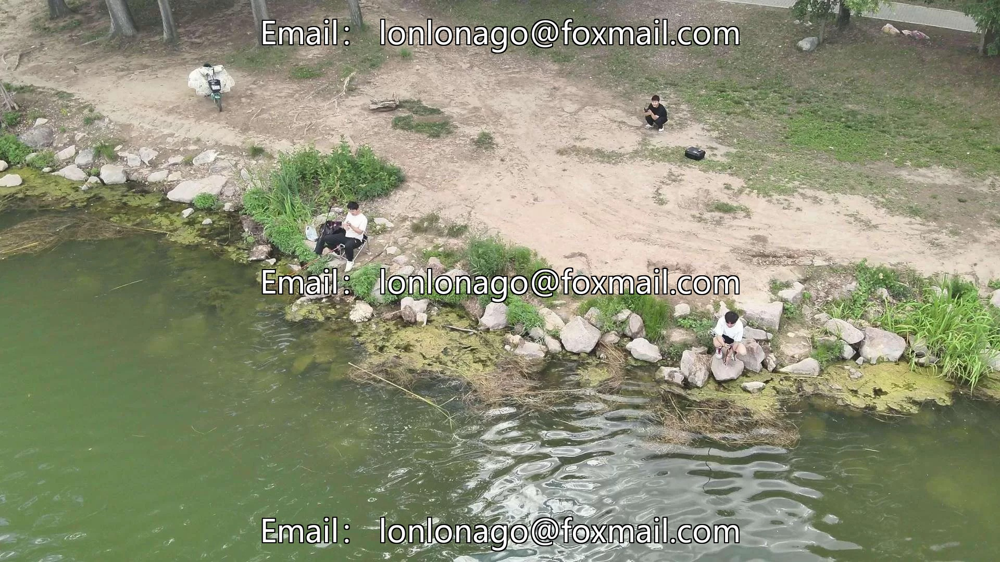

# Drone-view aerial photography riverside fishing detection dataset VOC+YOLO format

## Body

Drone-view aerial photography dataset of riverside fishing detection: VOC+YOLO format, 3952 images in 2 categories
Warm Reminder: Due to the dataset's replicability, please confirm compliance with requirements before purchasing.
Note: The dataset consists of video frames extracted from drone footage, all taken from the same scene, resulting in a relatively high number of duplicated scenes (actually not duplicated). Please refer to the provided images for details.
Dataset format: Pascal VOC format + YOLO format (excluding the segmentation path in the txt file, only including jpg images and corresponding VOC format xml files and yolo format txt files)
Number of images (number of jpg files): 3952

Number of annotations (XML file count): 3952
Number of annotations (txt file count): 3952
Number of annotation categories: 2
Annotation category names (Note that the order in yolo format does not correspond to this, but refer to the classes.txt in the labels folder): ["fisherman", "person"]
Each category annotation box count and image count
"fisherman" (Fishing person) box count = 4584, image count = 3880
"person" (Non-fishing person) box count = 2383, image count = 2372
Total box count: 6967
Image resolution: 1920x1080
Annotation tool used: labelImg

Annotation rules: Draw a rectangle around the category.
Important Notice: The dataset does not have separate training, validation, and test sets; you need to partition them yourself.
Special : This dataset does not guarantee the accuracy of the trained models or weight files.

## Images

## Payment

Here is a pay link on Stripe ( https://buy.stripe.com/3cs8yP7sY87d0vu9AB ). Please contact me lonlonago@foxmail.com after funding $89, and I will send you a complete data files , thank you!

